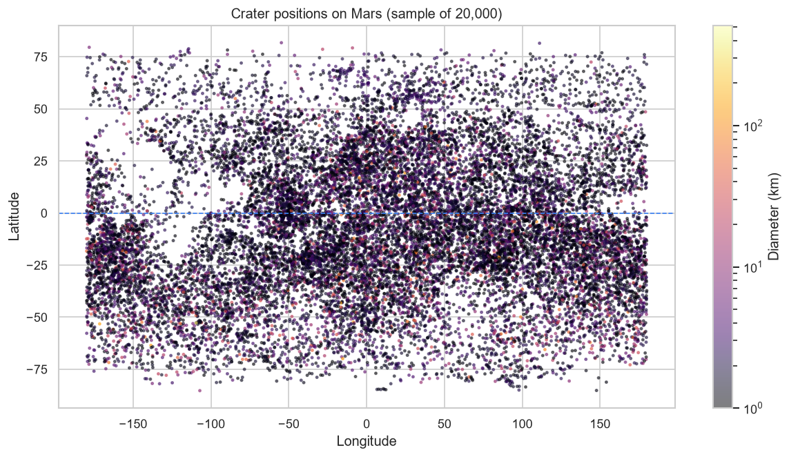
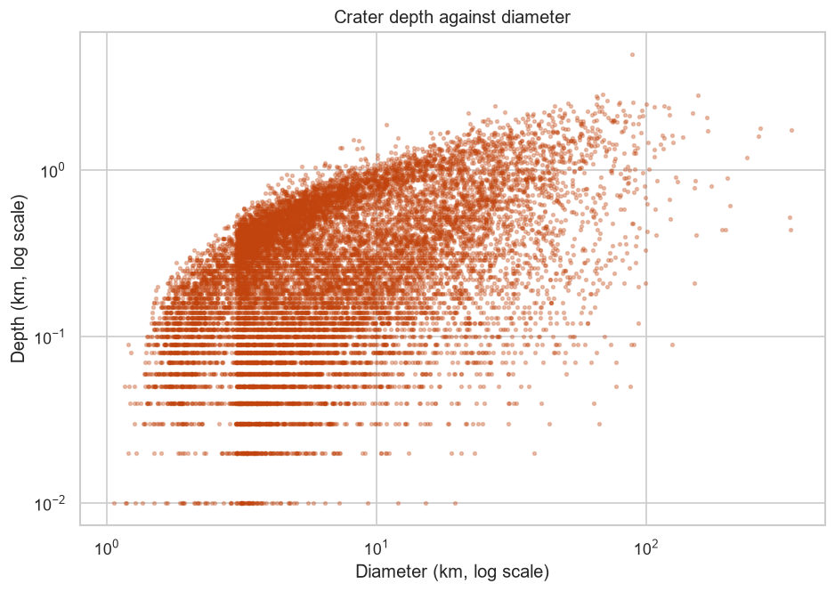

# Data Analysis with Python

NumPy, pandas, Matplotlib and Seaborn — the learning notebooks, plus a
full analysis pipeline built from them.

The pipeline analyses **384,343 Martian impact craters** from the NASA
Planetary Data System. One command loads the raw 17 MB export, cleans it,
prints a statistical report and writes seven charts.

```bash
pip install -r requirements.txt

python main.py                # the analysis pipeline
python main.py --no-charts    # statistics only

cd notebooks && jupyter notebook   # the learning notebooks
```

## Two halves

| | |
|---|---|
| [`notebooks/`](notebooks/) | Seven notebooks covering NumPy, pandas and visualisation, with assignments and solutions. All outputs committed, so they render on GitHub without running. |
| `main.py` + [`src/`](src/) | The same techniques as a reusable package: load, clean, aggregate, plot. |

## What it does

| Stage | Module | Detail |
|---|---|---|
| Load & clean | [`src/loader.py`](src/loader.py) | Strips whitespace headers, converts blank-string nulls to real `NaN`, coerces numerics, drops rows with no diameter |
| Feature engineering | [`src/loader.py`](src/loader.py) | Adds `SIZE_CLASS` (`pd.cut` into 5 bins), `HEMISPHERE`, `IS_NAMED` |
| Statistics | [`src/analysis.py`](src/analysis.py) | NumPy descriptives, z-score normalisation, missing-value report, correlation matrix |
| Aggregation | [`src/analysis.py`](src/analysis.py) | `groupby().agg()` across size class, hemisphere and ejecta morphology |
| Charts | [`src/plots.py`](src/plots.py) | 7 PNGs into `outputs/` via the Agg backend |

## Findings

**The depth-to-diameter ratio collapses as craters grow.**

| Size class | Craters | Mean depth/diameter |
|---|---|---|
| tiny (<2 km) | 3,694 | 0.0582 |
| small (2–5 km) | 29,240 | 0.0664 |
| medium (5–20 km) | 33,306 | 0.0460 |
| large (20–100 km) | 10,280 | 0.0231 |
| huge (100 km+) | 284 | 0.0091 |

Small craters hold a roughly constant ratio near 0.06 — the signature of
simple bowl-shaped craters. Past about 5 km the ratio falls sevenfold. That
is the **simple-to-complex crater transition**: large impacts collapse under
their own gravity into shallow, flat-floored basins with central peaks.

**The southern hemisphere is more heavily cratered.**

| Hemisphere | Craters | Mean diameter | Largest |
|---|---|---|---|
| Northern | 150,894 | 3.132 km | 408.23 km |
| Southern | 233,449 | 3.831 km | 1164.22 km |

55% more craters in the south, and they are larger on average. This matches
the known Martian dichotomy — ancient, heavily cratered southern highlands
against resurfaced northern lowlands.

**Other results**

- Diameters are heavily right-skewed: median 1.53 km, mean 3.56 km, max 1164 km. Every diameter chart uses a log axis for this reason.
- Only **0.26%** of craters are named (987 of 384,343).
- Diameter correlates with depth at **r = 0.587**; latitude correlates with nothing (|r| < 0.06), so crater size is independent of latitude.
- `Rd` (radial ejecta) is the most common morphology at 24,892 craters, but multi-layer `MLERS` craters are the largest at 19.77 km mean diameter.

## Charts



*Crater positions, colour-coded by diameter. The density asymmetry either
side of the equator (dashed line) is the Martian dichotomy.*



*Depth against diameter on log-log axes. The bend away from a straight
line past ~5 km is the simple-to-complex crater transition.*

| File | Chart |
|---|---|
| `01_diameter_distribution.png` | Log-scale histogram of diameters |
| `02_size_class_counts.png` | Bar chart of counts per size class |
| `03_hemisphere_comparison.png` | Box plot, diameter by hemisphere |
| `04_spatial_scatter.png` | Lat/long scatter, colour = diameter (log norm) |
| `05_correlation_heatmap.png` | Annotated correlation matrix |
| `06_depth_vs_diameter.png` | Log-log depth against diameter |
| `07_mtcars_mpg_by_cylinder.png` | Grouped bar chart on the mtcars dataset |

## Layout

```
Data-Analysis-with-Python/
├── main.py                  CLI entry point
├── data/
│   ├── marscrater_pds.csv   384k craters, NASA PDS
│   ├── mtcars.csv           32 cars, grouped-bar example
│   ├── EP.health.csv        168 rows, time-series example
│   └── data.xlsx            3 rows, read_excel example
├── src/
│   ├── loader.py            load + clean + derive
│   ├── analysis.py          statistics + aggregation
│   └── plots.py             chart generation
├── notebooks/               the learning notebooks
│   ├── numpy.ipynb
│   ├── Pandas.ipynb
│   ├── Visualization.ipynb
│   └── *assignments/solutions.ipynb
└── outputs/                 generated PNGs
```

See [`notebooks/README.md`](notebooks/README.md) for what each notebook
covers, and which cells are expected to raise.

## Notes on the data

The raw PDS export has one trap that is easy to miss and changes every
conclusion you draw from it.

**Missing values are encoded as a single space, not an empty field.**
`pd.read_csv` reads them as the string `' '`, which is not null as far as
pandas is concerned:

```python
df = pd.read_csv('data/marscrater_pds.csv')

df['CRATER_NAME'].isnull().sum()                          # 0
(df['CRATER_NAME'].str.strip() == '').sum()               # 383,356
```

So `.isnull().sum()` reports **zero** missing values on a column that is
actually 99.7% empty. Any missing-data audit that trusts it is wrong
before it starts. The fix is one line:

```python
df = df.replace(r'^\s*$', pd.NA, regex=True)
```

The file also carries a UTF-8 BOM. Pandas strips it automatically, so
`df['CRATER_ID']` works either way; `loader.py` passes `utf-8-sig`
explicitly to make that deliberate rather than lucky.

Run `python main.py --no-charts` to print the statistics without generating plots.
